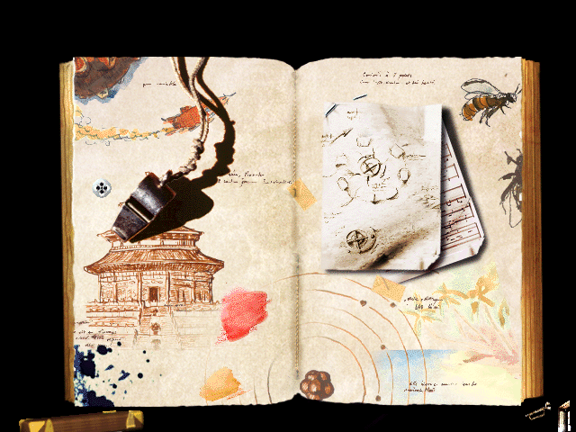
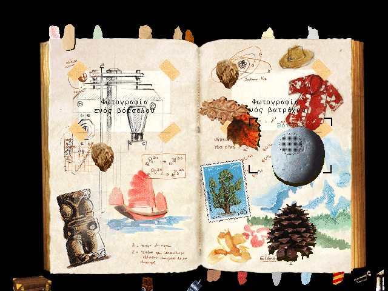
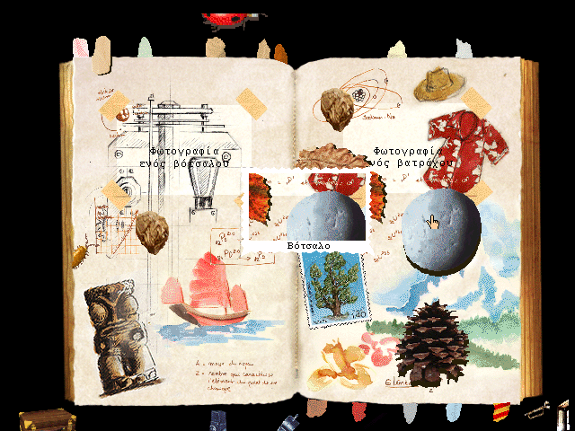
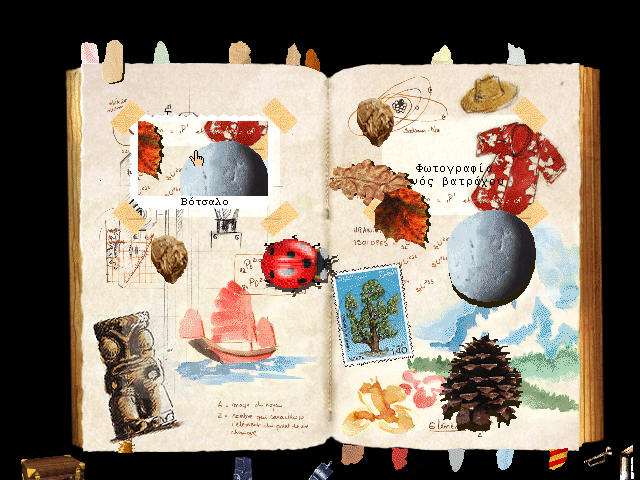

# Το Μαγικό Άλμπουμ του Θείου Αλβέρτου (1999 Greek Edition)
### *Uncle Albert's Magical Album* (`mtropolis:albert1`) — Digital Preservation & WebAssembly Port

[](https://www.scummvm.org/)
[](https://www.gnu.org/licenses/old-licenses/gpl-2.0.html)
[](#)

A digital preservation, reverse-engineering, and browser port of **Το Μαγικό Άλμπουμ του Θείου Αλβέρτου** (*L'Album secret de l'oncle Ernest* / *Uncle Albert's Magical Album*), developed by **Lexis Numérique**, published by **Emme Interactive**, and localized into Greek by **MLS LaserSoftware / Πήγασος Interactive (1999)** on the **mTropolis 2.0** engine.

---

## 🎮 Play in Browser (Desktop & Mobile/Touchscreen)

You can play the complete Greek edition directly in any modern browser (Chrome, Firefox, Safari, Edge) with zero installation via GitHub Pages:

> 🌐 **[Play Uncle Albert's Magical Album in Browser](https://plympe.com/uncle-albert-magical-album-greek/)** *(Mirror: [panlybero.github.io/uncle-albert-magical-album-greek](https://panlybero.github.io/uncle-albert-magical-album-greek/))*

### Controls (Desktop & Touchscreen)
- **🖱️ Trackpad Mode (Touchscreens)**: Swipe anywhere on the screen to move the virtual cursor relatively with `Mouse Over` hover preservation (required for the flashlight, Polaroid camera viewfinder, and magnifying glass).
- **👆 Tap / Click**: Single tap or left click to interact.
- **✋ Drag & Drop (`Σύρσιμο` button or Double-Tap-and-Hold)**: Pick up collectibles and photos, store them on the left border (`cardass`), and attach photos into album frames (`zone_photo1` / `zone_photo2`).
- **⌨ Greek & Latin Keyboard (`Πληκτρολόγιο`)**: Enter player names in Greek (`Windows-1253` / Unicode) or Latin on the album selection screen (`choisis`).
- **⏭ Skip Intro (`Παράλειψη` / `Esc` / Tap)**: Skip the intro video cleanly to the first album spread (`00-depart`).

---

## 📸 Visual Verification

| Album Spread (`00-depart`) | Polaroid Viewfinder (`photo_viseur`) |
| :---: | :---: |
|  |  |
| *Opening album spread with tape recorder (`magneto`)* | *Camera viewfinder centered on pebble (`Βότσαλο`)* |

| Developed Photo (`photo1`) | Border Scaling & Frame Attachment (`zone_photo2`) |
| :---: | :---: |
|  |  |
| *Developed Polaroid with serrated border and Greek caption* | *Photo scaled from border slot and attached into album frame* |

---

## 🔬 Summary of Reverse-Engineered Engine Fixes

> 📘 Full technical documentation covering the disc layout, all 137 mTropolis scenes, and all 18 subsystems fixed in ScummVM is available in **[`docs/TECHNICAL_FINDINGS.md`](docs/TECHNICAL_FINDINGS.md)**.

1. **Game Detection, Boot Configuration & Greek Encodings**:
   - Added `MTBOOT_ALBERT1_WIN_EL` (`GID_ALBERT1`, `Common::EL_GRC`, `ALBUM.EXE` + `album_gr1.MPL`) and `Windows1253GreekFont` for dynamic `TextLabelElement` rendering (player names and Polaroid photo captions).
2. **Native mTropolis Template Save Loading (`ALBUM/DATA/SAUVE`)**:
   - Implemented `Project::loadModifierFromNativeSaveFile` and `ListVariableModifier` native stream deserialization so starting a new profile loads initial coordinates, pages, and states for every collectible and creature across all 50 playable spreads.
3. **Full `Hoologic` Bitmap Plug-In (`BITMAP.R95`) & `Thereware::RotatorModifier` (`ROTATORK.R95`)**:
   - Implemented `BitmapVariableModifier`, `CaptureBitmapModifier`, `DisplayBitmapModifier`, `ScaleBitmapModifier` (including dynamic `_dimensionsSource` via `1a2d70 'echelle'`), `ImportBitmapModifier`, `SaveBitmapModifier`, and `PrintBitmapModifier` for the 4-slice page-turn transition and Polaroid camera.
4. **Polaroid Camera Viewfinder, Border Storage & Frame Attachment (`photo_placee`)**:
   - Applied `WorldManagerInterface::_cursorHotspot` (`(75, 50)`) to `Runtime::updateCursorElementPosition()`, excluded `objet_vise` from bitmap capture, reset initially-hidden child elements (`cadre`, `texte`, `cardass`) on reparenting (`executeChangeObjectParent`), and implemented `"element"` in `Modifier::writeRefAttribute` so `source(3).parent.element.globalposition := element(1).globalposition` attaches photos into `zone_photo1` / `zone_photo2`.
5. **Low-Latency HTTP Range Streaming & 16 MB CDN Sharding (`ChunkedHTTPReadStream`)**:
   - Implemented a 4-slot C++ LRU chunk reader with synchronous JS cache hits (`0 ms` without `Asyncify` stack unwind), `+3 MB` background prefetching, pause-aware QuickTime video/audio clocks, and transparent 16 MB `.partXX` shard resolution for the 359 MB `album_gr2.MPX` container on GitHub Pages.

---

## 📁 Repository Structure

```text
uncle-albert-magical-album-greek/
├── docs/
│   ├── TECHNICAL_FINDINGS.md          # Complete technical reference & engine fix catalog
│   └── screenshots/                   # In-engine verification captures
├── patches/
│   └── scummvm-greek-albert.patch     # Full ScummVM mTropolis & Emscripten patch
├── tools/
│   ├── patch_scummvm_js.py            # Post-build patcher for Emscripten scummvm.js
│   ├── build-make_http_index.py       # HTTP filesystem index.json generator
│   └── serve_range.py                 # Local multi-threaded HTTP 206 Range test server
├── web/                               # WebAssembly player deployed to GitHub Pages
└── run_albert.sh                      # Desktop launcher script
```

---

## ⚖️ Legal & Disclaimer

*Το Μαγικό Άλμπουμ του Θείου Αλβέρτου* (*L'Album secret de l'oncle Ernest*) is © 1998–1999 Lexis Numérique / Emme Interactive / MLS LaserSoftware / Πήγασος Interactive. This project is created strictly for non-commercial historical preservation, accessibility, and educational purposes. All reverse-engineered engine patches, tools, and scripts are licensed under the GNU General Public License v2.0.
