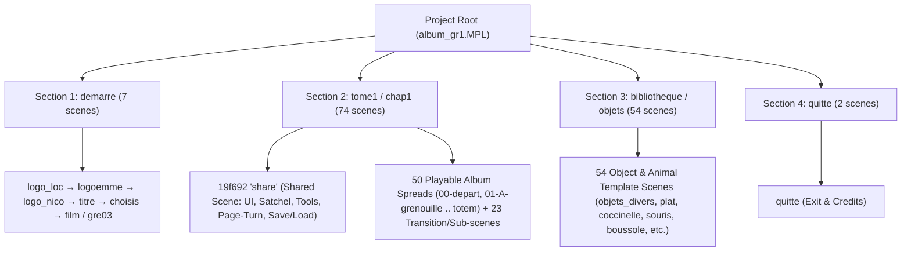

# Comprehensive Technical Documentation: *Uncle Albert's Magical Album* (`mtropolis:albert1` — Greek Windows Edition)

**Last Updated**: 2026-10-24  
**Workspace**: `/home/plympe01/workspace/game-archeology/albert`  
**Active Album Workspace**: `/home/plympe01/workspace/game-archeology/albert/album`  
**ScummVM Worktree**: `/home/plympe01/workspace/game-archeology/albert/scummvm` (branch `albert`)  
**WebAssembly Build & Player**: `/home/plympe01/workspace/game-archeology/albert/build-wasm` & `/home/plympe01/workspace/game-archeology/albert/web`  
**Extracted Game Data**: `/home/plympe01/workspace/game-archeology/albert/album/iso_contents`

---

## 1. Game Overview, Disc Layout & File Architecture

### 1.1 Series Overview & Editions
The *Uncle Albert* (*L'Oncle Ernest* / *Θείος Αλβέρτος*) series was developed by **Lexis Numérique** and published by **Emme Interactive** (localized into Greek by **MLS LaserSoftware / Πήγασος Interactive**, 1999) using the **mTropolis 2.0 (mFactory)** multimedia authoring engine:
1. **`Album.iso` (`mtropolis:albert1`, Greek Windows Edition — Complete & Verified)**:
   - Greek Title: *Το Μαγικό Άλμπουμ του Θείου Αλβέρτου* (*Το μυστικό άλμπουμ του θείου Αλβέρτου*)
   - Original French Title: *L'Album secret de l'oncle Ernest*
   - Engine: **mTropolis 2.0 Windows (`ALBUM.EXE` / `MTPLAY32`)**
   - Resolution & Color Depth: `640×480`, 32-bit / 16-bit RGB (`enhancedColorDepthMode = kColorDepthMode32Bit`, fallback `preferredColorDepthMode = kColorDepthMode8Bit`).
2. **`voyage.iso` (`mtropolis:albert2`)**: *Uncle Albert's Fabulous Voyage* (*Το Φανταστικό Ταξίδι του Θείου Αλβέρτου*).
3. **`island_gre.iso` (`mtropolis:albert3`)**: *Uncle Albert's Mysterious Island* (*Το Μυστηριώδες Νησί του Θείου Αλβέρτου*).

### 1.2 `Album.iso` Hybrid CD-ROM Layout & Key Files
`Album.iso` is a hybrid ISO9660/HFS CD-ROM extracted to [`/home/plympe01/workspace/game-archeology/albert/album/iso_contents/`](file:///home/plympe01/workspace/game-archeology/albert/album/iso_contents):
- **Hybrid ISO Shared Extent (`album_gr2.MPX`)**:
  - On the original CD-ROM, `ALBUM/DATA/album_gr2.MPX` and root `album_gr2.MPX` (`359,038,939` bytes) point to the same ISO9660 extent. In `iso_contents/`, `ALBUM/DATA/album_gr2.MPX` is symlinked to `../../album_gr2.MPX`.
- **Core Executable & mTropolis Segments**:
  - `ALBUM/DATA/ALBUM.EXE` (`757,760` bytes, MD5 of first 5,000 bytes: `0e513dac9d2a0d7cfcdc670cab2a9bda`): mTropolis 2.0 Windows 32-bit player executable containing embedded `MPLD` segment descriptors referencing `album_gr1.MPL` and `album_gr2.MPX`.
  - `ALBUM/DATA/album_gr1.MPL` (`17,410,545` bytes, MD5 of first 5,000 bytes: `9b7b619434abfa6139a59b0da7acb9e5`): Primary project structure, boot stream, global modifiers, and all **137 scene streams** (`demarre`, `tome1/chap1`, `bibliotheque/objets`, `quitte`).
  - `ALBUM/DATA/album_gr2.MPX` (`359,038,939` bytes): External media asset segment containing QuickTime movies (including the 27.4 MB intro movie `19d81b 'intro'` at offset `16,939,502..44,357,270`), MToon sprite animations, images, and audio streams.
- **mTropolis 2.0 Plug-In Extensions (`ALBUM/DATA/RESOURCE/`)**:
  - `BASIC.X95` (`242,688` bytes): Standard mTropolis modifiers (`Messenger`, `IfMessenger`, `Behavior`, `CompoundVariable`, `ListVariable`, `ObjectReferenceVariable`, `SaveAndRestore`, `SysInfo`, etc.).
  - `BITMAP.R95` (`81,408` bytes): **Hoologic** bitmap manipulation plug-in (`BitmapVariableModifier`, `CaptureBitmapModifier` / `PainterModifier`, `DisplayBitmapModifier`, `ScaleBitmapModifier`, `ImportBitmapModifier`, `SaveBitmapModifier`, `PrintBitmapModifier`).
  - `ROTATORK.R95` (`66,560` bytes): **Thereware** `RotatorModifier` plug-in for circular/orbital motion (`coccinelle`, `boussole`, etc.).
  - `CURSORS.C95` (`87,040` bytes): Custom animated/static hardware cursor resources (`magn_curs`, `main_ouverte`, `main_fermee`, etc.).
  - `EXTRAS.R95` (`185,344` bytes): Additional mTropolis 2.0 runtime resources.
- **Pre-Populated Native mTropolis Data Files (`ALBUM/DATA/`)**:
  - `ALBUM/DATA/SAUVE` (`18,497` bytes): Default initial state file for the `CompoundVariableModifier` `sauve_jeux` (`0x1a0ca1`), loaded via `SaveAndRestoreModifier` (`19f79c 'sauve'`) when starting a new player profile (`v_nouvelle_partie == 1`). Contains default positions, scenes, layers, and state flags for all interactive objects and animals across the album.
  - `ALBUM/DATA/liste_pages` (`117,948` bytes): Default persistent page metadata table.
  - `ALBUM/DATA/textes_labo.dat` (`23,483` bytes): Localized Greek laboratory text strings.
  - `ALBUM/DATA/PHOTO1/PHOTO0` .. `ALBUM/DATA/PHOTO10/PHOTO0` (`10,978` bytes each): Default initial 24-bit Windows BMP files (`108×80`) for the Polaroid camera album slots.

---

## 2. Project Architecture, Scene Hierarchy & Gameplay Mechanics

### 2.1 Project Sections & All 137 Scenes (`album_gr1.MPL`)
The mTropolis project root is divided into **4 Sections** containing **137 Scenes** in total:



1. **Section `demarre` (`19ec58`, 7 scenes)**:
   - `19ef9b 'logo_loc'` (MLS LaserSoftware Greek publisher logo) -> `19edd5 'logoemme'` (Emme Interactive logo) -> `19ecac 'logo_nico'` (Lexis Numérique logo) -> `19ef61 'titre'` (Main title screen) -> `19f300 'choisis'` (8-slot album profile selection & Greek/Latin name entry).
   - From `choisis`:
     - **New Save (`v_nouvelle_partie = 1`)**: Selecting an unwrapped slot (`album1..8`), typing a name into `nom1..8`, and pressing `Enter` (or clicking the green checkmark) sets `v_nouvelle_partie = 1`, loads the template `ALBUM/DATA/SAUVE` via `init_sauve`, and transitions to `19ed77 'film'` (`19d81b 'intro'` QuickTime movie, `320×240` centered at `(160, 120)..(480, 360)`), which then transitions to `00-depart`.
     - **Existing Save (`v_nouvelle_partie = 0`)**: Clicking an already-named album slot loads `albert1.sauve<N>`, transitions through `19f1f5 'gre03'` (animated frog intro), restores satchel items (`prepare_clonage`), and jumps directly to the player's saved album page (`num_page`).
2. **Section `tome1` / Subsection `chap1` (74 scenes)**:
   - **Shared Scene `19f692 'share'`**: Remains mounted alongside every gameplay scene in `tome1/chap1`. Manages:
     - **Satchel (`13e4c9 'cardass'`)**: Top-left inventory grid (`plan1..plan6`) where draggable items (`objets_divers`, `plat`, `coccinelle`, etc.) are stored, dynamically scaled down (`tr_cardass_unit`), and persisted across page turns and save/load.
     - **Shared Tools**: Flashlight (`torche`), Polaroid camera (`appphoto.pct` / `1a42a8 'appphotos_mt'` / `photo_viseur`), magnifying glass (`loupe`), whistle/hint button (`8e5d0 'sonnette'` / `aide`), and bookmark navigation tabs (`p08`, etc.).
     - **Page-Turn Engine**: Captures the current page (`garder_image` via `Hoologic::CaptureBitmapModifier`), animates the 4 page-turn slices (`1a1640`, `1a1246`, `1a3b0e`, `1a1d6b` via `reduit_page` / `reduire_page` / `Hoologic::ScaleBitmapModifier` & `DisplayBitmapModifier`), clones objects belonging to the destination page (`boucle_cherche` / `boucle_scene`), and reveals the new spread (`cache_page` -> `liberer_changeur`).
   - **50 Playable Album Spreads**: Starting at `19f6b4 '00-depart'` (with the tape recorder `magneto` tutorial and Uncle Albert's video `tom1`), `01-A-grenouille`, `01-B-cinema`, `02-A-jardin`, ..., `10-C-sous-terrain`, up to `totem`.
3. **Section `bibliotheque` / Subsection `objets` (54 scenes)**:
   - Master template repository for all interactive items, puzzles, and autonomous creatures (`1381c2 'objets_divers'`, `plat`, `plat_petit`, `coccinelle_originale`, `escargot`, `araignee`, `mouche`, `boussole`, `fossile`, `scorpion`, `fourmi`, `souris`, `detecteur`, `cerf_volant`, `speedy`, `papillon`, `cloporte`, etc.).
4. **Section `quitte` (2 scenes)**:
   - Wooden quit confirmation and save-game prompt (`quitter` -> `save` -> `prepare_sauvegarde` -> `quitte`).

### 2.2 Dynamic Object Cloning & Page Population Pipeline
Whenever an album spread loads (or when a saved game restores the satchel), `19f692 'share'` runs a message-driven loop to instantiate items from `bibliotheque/objets`:
1. `boucle_cherche` scans the `sauve_jeux` (`SAUVE`) lists (`l_nom`, `l_scene`, `l_x`, `l_y`, `l_layer`, `l_visible`, `l_cardass`, etc.) for entries matching the active scene's `num_page` (or `cardass`).
2. For each match, `share` dispatches `(900, 47) 'cloner'` (or runs `boucle_scene` walking `nextsibling` on `1381c2 'objets_divers'`) and triggers a `Clone` behavior (`EventIDs::kElementCloned = (226, 0)`).
3. The cloned element's `Clone (226, 0)` handler (`13d230 'Init_animal_retour'` or `init_objet`) reads its target scene, coordinates, and layer from `objet` / `liste_chose`, sets `element.parent = objet.scene`, and sends `(900, 51) 'fin_clonage_objet'` (or `(900, 55) 'fin_clonage'`) back to `share`.
4. Once all items for the page are cloned and reparented, `share` executes the page-turn reveal (`tourner_page` -> `reduire_page` -> `cache_page` -> `liberer_changeur`).

---

## 3. Complete Catalog of Engine & Backend Fixes (`scummvm` branch `albert`)

All 35 modified files in [`/home/plympe01/workspace/game-archeology/albert/scummvm`](file:///home/plympe01/workspace/game-archeology/albert/scummvm) are documented below by subsystem.

### 3.1 Game Detection, Boot Table & Character Encodings (`MacGreek` / `Windows-1253`)
- **Files**:
  - [`engines/mtropolis/detection.h`](file:///home/plympe01/workspace/game-archeology/albert/scummvm/engines/mtropolis/detection.h#L136)
  - [`engines/mtropolis/detection.cpp`](file:///home/plympe01/workspace/game-archeology/albert/scummvm/engines/mtropolis/detection.cpp#L104)
  - [`engines/mtropolis/detection_tables.h`](file:///home/plympe01/workspace/game-archeology/albert/scummvm/engines/mtropolis/detection_tables.h#L684-L704)
  - [`engines/mtropolis/boot.cpp`](file:///home/plympe01/workspace/game-archeology/albert/scummvm/engines/mtropolis/boot.cpp#L2057-L2061)
  - [`common/str-enc.h`](file:///home/plympe01/workspace/game-archeology/albert/scummvm/common/str-enc.h#L50), [`common/str-enc.cpp`](file:///home/plympe01/workspace/game-archeology/albert/scummvm/common/str-enc.cpp#L1004-L1005), [`common/enc-internal.h`](file:///home/plympe01/workspace/game-archeology/albert/scummvm/common/enc-internal.h#L38), [`common/encodings/singlebyte.cpp`](file:///home/plympe01/workspace/game-archeology/albert/scummvm/common/encodings/singlebyte.cpp#L188-L205)
- **Details**:
  - Added `MTBOOT_ALBERT1_WIN_EL` (`GID_ALBERT1`, `Common::EL_GRC`, `Common::kPlatformWindows`) matching `ALBUM.EXE` (`757,760` bytes) and `album_gr1.MPL` (`17,410,545` bytes), and added `"ALBUM"` to `directoryGlobs` so ScummVM detects the game from either the CD root (`iso_contents/`) or `ALBUM/DATA/`.
  - Added `Common::kMacGreek` (`kMacGreekConversionTable`) to ScummVM's encoding tables alongside `Windows-1253`.

### 3.2 Display Color Depth Fallback (`MTropolisEngine::run`)
- **File**: [`engines/mtropolis/mtropolis.cpp`](file:///home/plympe01/workspace/game-archeology/albert/scummvm/engines/mtropolis/mtropolis.cpp#L255-L286)
- **Problem**: `album_gr1.MPL` specifies `preferredColorDepthMode = kColorDepthMode8Bit` and `enhancedColorDepthMode = kColorDepthMode32Bit`. When 32-bit was not initially selected, the fallback loop jumped straight to 8-bit `CLUT8`, corrupting 16-bit graphics and preventing 24-bit Cinepak video playback.
- **Fix**: Updated the fallback loop to step downward from `enhancedColorDepthMode - 1` down to `preferredColorDepthMode`, selecting 16-bit RGB (`RGB565`) if 32-bit is unavailable.

### 3.3 mTropolis 2.0 Binary Data Format & Miniscript Quirks
- **Files**:
  - [`engines/mtropolis/data.h`](file:///home/plympe01/workspace/game-archeology/albert/scummvm/engines/mtropolis/data.h#L475) & [`engines/mtropolis/data.cpp`](file:///home/plympe01/workspace/game-archeology/albert/scummvm/engines/mtropolis/data.cpp#L548-L554)
  - [`engines/mtropolis/runtime.cpp`](file:///home/plympe01/workspace/game-archeology/albert/scummvm/engines/mtropolis/runtime.cpp#L1404-L1407), [`runtime.cpp`](file:///home/plympe01/workspace/game-archeology/albert/scummvm/engines/mtropolis/runtime.cpp#L3060), [`runtime.cpp`](file:///home/plympe01/workspace/game-archeology/albert/scummvm/engines/mtropolis/runtime.cpp#L4611)
  - [`engines/mtropolis/miniscript.cpp`](file:///home/plympe01/workspace/game-archeology/albert/scummvm/engines/mtropolis/miniscript.cpp#L556-L567)
- **Details**:
  1. **`PlugInTypeTaggedValue::kVector = 0x10` (24-byte vector)**: Added support for tag `0x10` (`XPFloatVector` + 3rd platform float) in mTropolis 2.0 plug-in data streams, converting radians to degrees via `AngleMagVector::createRadians`.
  2. **Author-Cleared NOP Bytecode (`opcode 0x0000`)**: Mapped `opcode 0x0000` in [`MiniscriptParser::resolveOpcode`](file:///home/plympe01/workspace/game-archeology/albert/scummvm/engines/mtropolis/miniscript.cpp#L556-L567) as a non-fatal no-op instruction (`UnimplementedInstruction`) so author-cleared scripts (such as `duplique_photo` or cleared handlers in `10-C-sous-terrain`) execute without aborting.
  3. **`WorldManagerInterface` Attributes (`cursorelement` & `cursorhotspot`)**: Added `"cursorelement"` alias for `"cursor"` and `cursorhotspot` (`Common::Point`) read/write support on `WorldManagerInterface` (`wm.cursorhotspot`).
  4. **Attribute ID Lookup Table Fix**: Fixed upstream typo in `_getSetAttribIDsToAttribName` where `AttributeIDs::kAttribVisible` (`58`) was overwritten with `"loop"` instead of `AttributeIDs::kAttribLoop` (`19`).

### 3.4 Native mTropolis Save/Template File Loading (`SaveAndRestoreModifier`)
- **Files**:
  - [`engines/mtropolis/runtime.h`](file:///home/plympe01/workspace/game-archeology/albert/scummvm/engines/mtropolis/runtime.h#L2501)
  - [`engines/mtropolis/runtime.cpp`](file:///home/plympe01/workspace/game-archeology/albert/scummvm/engines/mtropolis/runtime.cpp#L8146-L8242)
  - [`engines/mtropolis/modifiers.cpp`](file:///home/plympe01/workspace/game-archeology/albert/scummvm/engines/mtropolis/modifiers.cpp#L451-L455)
  - [`engines/mtropolis/plugin/standard_data.cpp`](file:///home/plympe01/workspace/game-archeology/albert/scummvm/engines/mtropolis/plugin/standard_data.cpp#L138)
  - [`engines/mtropolis/plugin/standard.cpp`](file:///home/plympe01/workspace/game-archeology/albert/scummvm/engines/mtropolis/plugin/standard.cpp#L928)
- **Problem**: When starting a new game, `19f79c 'sauve'` (`SaveAndRestoreModifier`) loads `SAUVE` (`ALBUM/DATA/SAUVE`) into `1a0ca1 'sauve_jeux'` (`CompoundVariableModifier`) to populate the initial coordinates and page assignments of every collectible in the game. ScummVM only checked ScummVM user save files (`SaveFileManager`) and ignored native mTropolis save files on disc.
- **Fixes**:
  - Implemented [`Project::loadModifierFromNativeSaveFile`](file:///home/plympe01/workspace/game-archeology/albert/scummvm/engines/mtropolis/runtime.cpp#L8146-L8242) to parse native mTropolis save files (`0x28`-byte header + serialized modifier tree) from the game data directory when no user save file exists.
  - Updated `Data::Standard::ListVariableModifier::load` (revision 3) to read list contents when `(persistentFlag.value.asBoolean != 0) || (prefix.subObjectSize > 14)`, because native save files serialize list contents with `persistentFlag == 0`.

### 3.5 Visual Elements, Scene Transitions & Alpha Fades
- **Files**:
  - [`engines/mtropolis/runtime.cpp`](file:///home/plympe01/workspace/game-archeology/albert/scummvm/engines/mtropolis/runtime.cpp#L9169-L9189)
  - [`engines/mtropolis/modifiers.cpp`](file:///home/plympe01/workspace/game-archeology/albert/scummvm/engines/mtropolis/modifiers.cpp#L1554)
  - [`engines/mtropolis/elements.cpp`](file:///home/plympe01/workspace/game-archeology/albert/scummvm/engines/mtropolis/elements.cpp#L1308-L1315)
- **Fixes**:
  - Updated `VisualElementConsumeCommandCoroutine` so `kElementShow` and `kElementHide` also update `_visibleByDefault` on non-scene elements.
  - Fixed `SceneTransitionModifier` `timeDivisor` from `100` to `1000` (`_duration` is in milliseconds).
  - Added alpha modulation (`transBlitFrom`) for `kInkModeDefault` and `kInkModeCopy` in `ImageElement::render` when `alpha != 255`.

### 3.6 Text Editing & Keyboard Messenger (`choisis` Player Name Entry)
- **Files**:
  - [`engines/mtropolis/runtime.h`](file:///home/plympe01/workspace/game-archeology/albert/scummvm/engines/mtropolis/runtime.h#L2834-L2838) & [`engines/mtropolis/runtime.cpp`](file:///home/plympe01/workspace/game-archeology/albert/scummvm/engines/mtropolis/runtime.cpp#L9203-L9250)
  - [`engines/mtropolis/elements.h`](file:///home/plympe01/workspace/game-archeology/albert/scummvm/engines/mtropolis/elements.h#L334-L398) & [`engines/mtropolis/elements.cpp`](file:///home/plympe01/workspace/game-archeology/albert/scummvm/engines/mtropolis/elements.cpp#L1990-L2110)
  - [`engines/mtropolis/modifiers.cpp`](file:///home/plympe01/workspace/game-archeology/albert/scummvm/engines/mtropolis/modifiers.cpp#L2385-L2437)
- **Fixes**:
  - Implemented `kElementEnableEdit (207)`, `kElementDisableEdit (220)`, `kElementSelect (209)`, `kElementDeselect (210)`, and `kElementToggleSelect (213)`.
  - Implemented interactive keyboard text editing on `TextLabelElement` via `IKeyboardEventReceiver`.
  - Fixed `KeyboardMessengerModifier::checkKeyEventTrigger` to populate `outCharStr` for special keys (`kReturn`, `kEnter`, `kEscape`, `kBackspace`, `kTab`, `kDelete`, arrows).

### 3.7 Dynamic Asset Swapping (`.asset`, `.asset.preload`), `globalposition`, and List `.insert[i]`
- **Files**:
  - [`engines/mtropolis/elements.h`](file:///home/plympe01/workspace/game-archeology/albert/scummvm/engines/mtropolis/elements.h#L220-L297) & [`engines/mtropolis/elements.cpp`](file:///home/plympe01/workspace/game-archeology/albert/scummvm/engines/mtropolis/elements.cpp#L1214-L1997)
  - [`engines/mtropolis/runtime.h`](file:///home/plympe01/workspace/game-archeology/albert/scummvm/engines/mtropolis/runtime.h#L777) & [`engines/mtropolis/runtime.cpp`](file:///home/plympe01/workspace/game-archeology/albert/scummvm/engines/mtropolis/runtime.cpp#L3506-L3611)
  - [`engines/mtropolis/plugin/standard.cpp`](file:///home/plympe01/workspace/game-archeology/albert/scummvm/engines/mtropolis/plugin/standard.cpp#L1117-L1132)
- **Fixes**:
  - Implemented `.asset` read/write and `.asset.preload` sub-attribute write on `ImageElement`, `MToonElement`, and `SoundElement`, with `Project::forceLoadAsset` on-demand segment loading from `album_gr2.MPX`.
  - Implemented `globalposition` (and `.x` / `.y`) write support on `VisualElement`.
  - Implemented `DynamicList::insertDefaultAtIndex` and `attrib == "insert"` in `ListVariableModifier::writeRefAttributeIndexed` and `DynamicList::WriteProxyInterface::refAttribIndexed`.

### 3.8 Alias GUID Preservation & Structural Child Variable Forwarding
- **Files**:
  - [`engines/mtropolis/runtime.h`](file:///home/plympe01/workspace/game-archeology/albert/scummvm/engines/mtropolis/runtime.h#L2215)
  - [`engines/mtropolis/runtime.cpp`](file:///home/plympe01/workspace/game-archeology/albert/scummvm/engines/mtropolis/runtime.cpp#L168-L176), [`runtime.cpp`](file:///home/plympe01/workspace/game-archeology/albert/scummvm/engines/mtropolis/runtime.cpp#L3665-L3683), [`runtime.cpp`](file:///home/plympe01/workspace/game-archeology/albert/scummvm/engines/mtropolis/runtime.cpp#L3844-L3854)
- **Problem**: `instantiateIfAlias` overwrote a modifier's static GUID (`0x138dbc 'objet'`, `0x138823 'objet_ref'`, `0x139224 'photo'`) with the template alias's GUID (`0x46a20`, `0x46a21`), breaking `LocalRef` resolution in sibling Miniscripts.
- **Fixes**:
  - Preserved `oldStaticGUID` across `instantiateIfAlias` and registered both GUIDs in the linking scope.
  - Added child variable forwarding to `Structural::readAttributeIndexed` and `Structural::writeRefAttributeIndexed`.

### 3.9 Cloned Sibling Insertion Order & Deep Reference Remapping
- **Files**:
  - [`engines/mtropolis/runtime.h`](file:///home/plympe01/workspace/game-archeology/albert/scummvm/engines/mtropolis/runtime.h#L2219)
  - [`engines/mtropolis/runtime.cpp`](file:///home/plympe01/workspace/game-archeology/albert/scummvm/engines/mtropolis/runtime.cpp#L354-L370), [`runtime.cpp`](file:///home/plympe01/workspace/game-archeology/albert/scummvm/engines/mtropolis/runtime.cpp#L3702-L3712), [`runtime.cpp`](file:///home/plympe01/workspace/game-archeology/albert/scummvm/engines/mtropolis/runtime.cpp#L5432)
- **Fixes**:
  - Added [`Structural::addChildAfter`](file:///home/plympe01/workspace/game-archeology/albert/scummvm/engines/mtropolis/runtime.cpp#L3702-L3712) so cloned elements are inserted immediately after `sourceStructural` rather than after the sentinel `138252 'fin_clonage'`.
  - Updated `ObjectRefRemapper` to recurse into `IModifierContainer` and child `Structural` / `Modifier` hierarchies when cloning.

### 3.10 Child Variable Access on `BehaviorModifier`
- **Files**:
  - [`engines/mtropolis/modifiers.h`](file:///home/plympe01/workspace/game-archeology/albert/scummvm/engines/mtropolis/modifiers.h#L60-L63)
  - [`engines/mtropolis/modifiers.cpp`](file:///home/plympe01/workspace/game-archeology/albert/scummvm/engines/mtropolis/modifiers.cpp#L238-L287)
- **Fix**: Implemented `findChildByName` and child variable attribute forwarding (`readAttribute`, `readAttributeIndexed`, `writeRefAttribute`, `writeRefAttributeIndexed`) on [`BehaviorModifier`](file:///home/plympe01/workspace/game-archeology/albert/scummvm/engines/mtropolis/modifiers.cpp#L238-L287) so expressions like `liste_chose.l_nom[int]` resolve child `ListVariableModifier`s inside behaviors.

### 3.11 Dynamic Object Phase & Scheduler Ordering
- **File**: [`engines/mtropolis/runtime.cpp`](file:///home/plympe01/workspace/game-archeology/albert/scummvm/engines/mtropolis/runtime.cpp#L4694-L5077)
- **Fix**: Executed scheduled timer events (`_scheduler`) before `executeDynamicObjectBehaviors`, and enforced strict phase progression (`ParentChanges -> Clones -> ShowCloned -> Kills`) so parent changes queued by a `Clone (226, 0)` handler take effect on the next frame after the `boucle_scene` iterator advances `objet` to `nextsibling`.

### 3.12 Full `Hoologic` Bitmap Suite & `Thereware::RotatorModifier`
- **Files**:
  - [`engines/mtropolis/plugin/hoologic.h`](file:///home/plympe01/workspace/game-archeology/albert/scummvm/engines/mtropolis/plugin/hoologic.h#L36-L260) & [`engines/mtropolis/plugin/hoologic.cpp`](file:///home/plympe01/workspace/game-archeology/albert/scummvm/engines/mtropolis/plugin/hoologic.cpp#L29-L668)
  - [`engines/mtropolis/plugin/thereware.h`](file:///home/plympe01/workspace/game-archeology/albert/scummvm/engines/mtropolis/plugin/thereware.h#L36-L77) & [`engines/mtropolis/plugin/thereware.cpp`](file:///home/plympe01/workspace/game-archeology/albert/scummvm/engines/mtropolis/plugin/thereware.cpp#L31-L148)
  - [`engines/mtropolis/elements.h`](file:///home/plympe01/workspace/game-archeology/albert/scummvm/engines/mtropolis/elements.h#L47-L50), [`engines/mtropolis/elements.cpp`](file:///home/plympe01/workspace/game-archeology/albert/scummvm/engines/mtropolis/elements.cpp#L868-L883), [`engines/mtropolis/runtime.cpp`](file:///home/plympe01/workspace/game-archeology/albert/scummvm/engines/mtropolis/runtime.cpp#L9708-L9715)
- **Details**:
  - Implemented `Hoologic::BitmapVariableModifier` (with `"object"`, `"value"`, `"bitmap"`, `"width"`, `"height"` attributes) and the complete `Hoologic` bitmap operations suite (`CaptureBitmapModifier` / `PainterModifier`, `DisplayBitmapModifier`, `ScaleBitmapModifier`, `ImportBitmapModifier`, `SaveBitmapModifier`, `PrintBitmapModifier`), driving the page-turn animation (`garder_image` -> `reduit_page` -> `reduire_page`) and Polaroid camera (`appphotos_mt`).
  - Excluded `photo_viseur` (camera viewfinder) and `pointeur` (custom cursor) from [`collectPageOverlayElements`](file:///home/plympe01/workspace/game-archeology/albert/scummvm/engines/mtropolis/plugin/hoologic.cpp#L84-L96) during offscreen capture, and converted 24-bit decoded BMPs in `ImportBitmapModifier::consumeMessage` to the main window's pixel format (`XRGB8888`).
  - Implemented `Thereware::RotatorModifier` (`angle`, `distance`, `rate`, `steps`, `wraparound`) and forwarded visual attributes (`size`, `position`, `width`, `height`, `visible`, `layer`) to `findStructuralOwner()` when a `RotatorModifier` shares the name `'tourner'` with its owner/child visual element (`coccinelle`, `boussole`).

### 3.13 `CLUT8` Background Matte Color-Key Transparency (`1a4ea0 'cadre'`)
- **Files**:
  - [`engines/mtropolis/elements.h`](file:///home/plympe01/workspace/game-archeology/albert/scummvm/engines/mtropolis/elements.h#L209)
  - [`engines/mtropolis/elements.cpp`](file:///home/plympe01/workspace/game-archeology/albert/scummvm/engines/mtropolis/elements.cpp#L1282-L1382), [`elements.cpp`](file:///home/plympe01/workspace/game-archeology/albert/scummvm/engines/mtropolis/elements.cpp#L1739-L1768)
- **Problem**: `1a4ea0 'cadre'` (the `640×480` border frame at `layer=251` on `00-depart`) uses `kInkModeBackgroundMatte` (`0x224`) with `backColor = (255, 255, 255)` on an 8-bit `CLUT8` surface (`bytesPerPixel == 1`). Calling `optimized->format.ARGBToColor(0, r, g, b)` on a `CLUT8` `PixelFormat` always returned `0` instead of palette index `255`, drawing the white interior opaquely over the entire album spread and blocking mouse hit-testing.
- **Fixes**:
  - Resolved `transColorRGB8` against the active 8-bit palette in [`ImageElement::render`](file:///home/plympe01/workspace/game-archeology/albert/scummvm/engines/mtropolis/elements.cpp#L1282-L1318).
  - Implemented [`ImageElement::isMouseCollisionAtPoint`](file:///home/plympe01/workspace/game-archeology/albert/scummvm/engines/mtropolis/elements.cpp#L1352-L1382) and updated [`MToonElement::isMouseCollisionAtPoint`](file:///home/plympe01/workspace/game-archeology/albert/scummvm/engines/mtropolis/elements.cpp#L1739-L1768) so transparent matte pixels do not intercept mouse clicks.

### 3.14 Cloned Hierarchy Visibility, Scope Resolution & On-Demand Scene Hot-Loading
- **Files**:
  - [`engines/mtropolis/runtime.h`](file:///home/plympe01/workspace/game-archeology/albert/scummvm/engines/mtropolis/runtime.h#L1725), [`runtime.h`](file:///home/plympe01/workspace/game-archeology/albert/scummvm/engines/mtropolis/runtime.h#L1913)
  - [`engines/mtropolis/runtime.cpp`](file:///home/plympe01/workspace/game-archeology/albert/scummvm/engines/mtropolis/runtime.cpp#L3411-L3648), [`runtime.cpp`](file:///home/plympe01/workspace/game-archeology/albert/scummvm/engines/mtropolis/runtime.cpp#L3877-L3881), [`runtime.cpp`](file:///home/plympe01/workspace/game-archeology/albert/scummvm/engines/mtropolis/runtime.cpp#L4163-L4171), [`runtime.cpp`](file:///home/plympe01/workspace/game-archeology/albert/scummvm/engines/mtropolis/runtime.cpp#L5015-L5028), [`runtime.cpp`](file:///home/plympe01/workspace/game-archeology/albert/scummvm/engines/mtropolis/runtime.cpp#L7411-L7417)
  - [`engines/mtropolis/miniscript.cpp`](file:///home/plympe01/workspace/game-archeology/albert/scummvm/engines/mtropolis/miniscript.cpp#L1884-L1911)
- **Fixes**:
  - Recursively queued cloned `Structural` hierarchies into `_pendingShowClonedObject` and updated `kDynamicObjectPhaseShowCloned` to check `visual->isVisible() || visual->isVisibleByDefault()`.
  - Added `this->getChildren()` to `modifierScope` before materializing `_modifiers` in `Structural::materializeDescendents` and prevented non-variable/non-behavior modifiers (like `SoundEffectModifier` `adc13 'cardass'`) from shadowing `Structural` children (`128b4c 'cardass'`) in `ObjectLinkingScope::resolve`.
  - Enabled on-demand `hotLoadScene(this)` in `Structural::readAttribute`, `writeRefAttribute`, and `readAttributeIndexed` when `_sceneLoadState == kSceneNotLoaded` (e.g. `bibliotheque.objets.souris.souris` on `10-C-sous-terrain`), and added `Runtime::getPendingNewParent` so `scene.num_page` resolves against the queued target scene during `Clone (226, 0)`.

### 3.15 `ObjectReferenceVariableModifier` Unwrapping, `_setToSourceParentWhen`, & `MToonElement` Satchel Scaling
- **Files**:
  - [`engines/mtropolis/plugin/standard.h`](file:///home/plympe01/workspace/game-archeology/albert/scummvm/engines/mtropolis/plugin/standard.h#L178-L180) & [`engines/mtropolis/plugin/standard.cpp`](file:///home/plympe01/workspace/game-archeology/albert/scummvm/engines/mtropolis/plugin/standard.cpp#L511-L618)
  - [`engines/mtropolis/modifiers.cpp`](file:///home/plympe01/workspace/game-archeology/albert/scummvm/engines/mtropolis/modifiers.cpp#L2882-L2884)
  - [`engines/mtropolis/miniscript.cpp`](file:///home/plympe01/workspace/game-archeology/albert/scummvm/engines/mtropolis/miniscript.cpp#L821-L831)
  - [`engines/mtropolis/elements.cpp`](file:///home/plympe01/workspace/game-archeology/albert/scummvm/engines/mtropolis/elements.cpp#L1703-L1765)
- **Fixes**:
  - Unwrapped `ObjectReferenceVariableModifier` operands to their `.object` value in [`UnorderedCompareInstruction::execute`](file:///home/plympe01/workspace/game-archeology/albert/scummvm/engines/mtropolis/miniscript.cpp#L821-L831) and [`ObjectReferenceVariableModifier::scriptSetObject`](file:///home/plympe01/workspace/game-archeology/albert/scummvm/engines/mtropolis/plugin/standard.cpp#L609-L618) so comparisons like `if (curseur = magn_curs)` and `if (curseur = 0)` succeed.
  - Implemented `CompoundVariableModifier::getMessagePropagationContainer()` and `ObjectReferenceVariableModifier::_setToSourceParentWhen` (`(900, 47) 'cloner'`), preserving `_setToSourceParentWhen` across `Init_cloner` so saved satchel items restore on game reload.
  - Scaled `destRect` in [`MToonElement::render`](file:///home/plympe01/workspace/game-archeology/albert/scummvm/engines/mtropolis/elements.cpp#L1703-L1718) and unscaled mouse coordinates in [`MToonElement::isMouseCollisionAtPoint`](file:///home/plympe01/workspace/game-archeology/albert/scummvm/engines/mtropolis/elements.cpp#L1745-L1765) when `tr_cardass_unit` shrinks an `MToonElement` into a satchel slot.

### 3.16 Greek (`Windows-1253` / Unicode `U+0384..U+03CE`) Keyboard Input & `Windows1253GreekFont` Dynamic Text Rendering
- **Files**:
  - [`engines/mtropolis/elements.cpp`](file:///home/plympe01/workspace/game-archeology/albert/scummvm/engines/mtropolis/elements.cpp#L2282-L2770)
  - [`backends/events/sdl/sdl2-events.cpp`](file:///home/plympe01/workspace/game-archeology/albert/scummvm/backends/events/sdl/sdl2-events.cpp#L104-L148) & [`backends/events/sdl/sdl3-events.cpp`](file:///home/plympe01/workspace/game-archeology/albert/scummvm/backends/events/sdl/sdl3-events.cpp#L95-L150)
- **Fixes**:
  - Added [`unicodeGreekToWindows1253`](file:///home/plympe01/workspace/game-archeology/albert/scummvm/engines/mtropolis/elements.cpp#L2282-L2318) and [`Windows1253GreekFont`](file:///home/plympe01/workspace/game-archeology/albert/scummvm/engines/mtropolis/elements.cpp#L2320-L2465) (a custom 6×12 bitmap glyph renderer covering `Windows-1253` `0xA0..0xFF` while delegating `0x00..0x9F` to ScummVM's base font) so dynamic `TextLabelElement`s (player names `nom1..8` in `choisis` and Polaroid photo captions like `"Πασχαλίτσα"`) render crisp Greek text.
  - Fixed signed `char` line-wrapping bug in [`TextLabelElement::render`](file:///home/plympe01/workspace/game-archeology/albert/scummvm/engines/mtropolis/elements.cpp#L2665) (`static_cast<uint8>(lineStr[i]) < ' '`) so `0x80..0xFF` bytes are not treated as whitespace.
  - Enabled Greek Unicode (`0x0370..0x03FF`) in `SdlEventSource::mapKey` (`sdl2-events.cpp` & `sdl3-events.cpp`) and set `SDL_SetHint(SDL_HINT_KEYCODE_OPTIONS, "hide_numpad")` in `sdl3-events.cpp`.

### 3.17 Emscripten `ChunkedHTTPReadStream`, Intro Video (`19ed77 'film'` / `19d81b 'intro'`) Streaming & One-Tap Skip
- **Files**:
  - [`backends/fs/emscripten/emscripten-fs-factory.cpp`](file:///home/plympe01/workspace/game-archeology/albert/scummvm/backends/fs/emscripten/emscripten-fs-factory.cpp#L48-L58)
  - [`backends/fs/emscripten/http-fs.cpp`](file:///home/plympe01/workspace/game-archeology/albert/scummvm/backends/fs/emscripten/http-fs.cpp#L91-L406)
  - [`video/qt_decoder.cpp`](file:///home/plympe01/workspace/game-archeology/albert/scummvm/video/qt_decoder.cpp#L86-L130) & [`video/qt_decoder.cpp`](file:///home/plympe01/workspace/game-archeology/albert/scummvm/video/qt_decoder.cpp#L1185-L1200)
  - [`audio/mixer.cpp`](file:///home/plympe01/workspace/game-archeology/albert/scummvm/audio/mixer.cpp#L600-L618)
  - [`backends/timer/emscripten/emscripten-timer.cpp`](file:///home/plympe01/workspace/game-archeology/albert/scummvm/backends/timer/emscripten/emscripten-timer.cpp#L56-L70)
  - [`engines/mtropolis/elements.cpp`](file:///home/plympe01/workspace/game-archeology/albert/scummvm/engines/mtropolis/elements.cpp#L2055-L2096)
  - [`engines/mtropolis/modifiers.cpp`](file:///home/plympe01/workspace/game-archeology/albert/scummvm/engines/mtropolis/modifiers.cpp#L2080-L2104)
  - [`engines/mtropolis/runtime.cpp`](file:///home/plympe01/workspace/game-archeology/albert/scummvm/engines/mtropolis/runtime.cpp#L5985-L5996) & [`engines/mtropolis/runtime.cpp`](file:///home/plympe01/workspace/game-archeology/albert/scummvm/engines/mtropolis/runtime.cpp#L6877-L6886)
- **Problems Solved**:
  1. **On-Demand HTTP Range Streaming for 359 MB `album_gr2.MPX`**: Added [`ChunkedHTTPReadStream`](file:///home/plympe01/workspace/game-archeology/albert/scummvm/backends/fs/emscripten/http-fs.cpp#L228-L406) for files `> 2 MB`, fetching `512 KB` slices via HTTP `Range: bytes=start-end` (`206 Partial Content`).
  2. **Interleaved Audio/Video Chunk Thrashing & Zero-`Asyncify` Cache Hits**: In `19d81b 'intro'` (`16,939,502..44,357,270` in `album_gr2.MPX`), Cinepak video (`trak 1`) and IMA4 audio (`trak 2`) are interleaved ~300 KB apart and share a single `ChunkedHTTPReadStream`. Added a **4-slot C++ LRU buffer** (`kNumSlots = 4`), a synchronous `EM_JS` cache lookup ([`_httpFsTryGetCachedRange`](file:///home/plympe01/workspace/game-archeology/albert/scummvm/backends/fs/emscripten/http-fs.cpp#L101-L115)) that copies cached chunks in `0 ms` without unwinding the Wasm stack via `Asyncify`, and non-blocking background read-ahead prefetching (`_httpFsPrefetchAhead`, 6 chunks = `+3 MB` lookahead with in-flight Promise deduplication).
  3. **Pause-Aware Video/Audio/Timer Clocks During Network Wait**: Compensated `_startTime += decodeElapsedMs` when `decodeElapsedMs > 50` in [`QuickTimeDecoder::decodeNextFrame`](file:///home/plympe01/workspace/game-archeology/albert/scummvm/video/qt_decoder.cpp#L110-L120), increased QuickTime audio buffering lookahead to `1500 ms`, clamped `Channel::getElapsedTime()` inter-callback delta to `100 ms` in [`audio/mixer.cpp`](file:///home/plympe01/workspace/game-archeology/albert/scummvm/audio/mixer.cpp#L611-L613), clamped catch-up timer ticks in [`EmscriptenTimerManager::handler`](file:///home/plympe01/workspace/game-archeology/albert/scummvm/backends/timer/emscripten/emscripten-timer.cpp#L62-L64), and capped `MovieElement::playMedia` to at most 2 decoded frames per tick.
  4. **Note on QuickTime Edit Lists (`elst`)**: Verified that `19d81b 'intro'`'s 3-entry `elst` is valid and required (`edit[1]` and `edit[2]` repeat the final frames so `60460` media ticks fill `60580` movie ticks); `removeQuickTimeEdits` must **not** be enabled for `albert1`.
  5. **One-Tap & `Escape` Intro Skip on Brand-New Saves (`v_nouvelle_partie == 1`)**: Allowed `29c24 'If Messenger'` on `19d81b 'intro'` to fire `(900, 134)` on `Mouse Up` even when `v_nouvelle_partie == 1`, expanded hit-testing on `0x19d81b` to the full `640×480` stage, and wired `KEYCODE_ESCAPE` during `0x19ed77 'film'` to synthesize a skip click.

### 3.18 Polaroid Camera Viewfinder, Photo Border Scaling/Visibility & Frame Attachment (`photo_placee`)
- **Files**:
  - [`engines/mtropolis/runtime.h`](file:///home/plympe01/workspace/game-archeology/albert/scummvm/engines/mtropolis/runtime.h#L2139), [`runtime.h`](file:///home/plympe01/workspace/game-archeology/albert/scummvm/engines/mtropolis/runtime.h#L2859), [`runtime.h`](file:///home/plympe01/workspace/game-archeology/albert/scummvm/engines/mtropolis/runtime.h#L2991)
  - [`engines/mtropolis/runtime.cpp`](file:///home/plympe01/workspace/game-archeology/albert/scummvm/engines/mtropolis/runtime.cpp#L2324-L2329), [`runtime.cpp`](file:///home/plympe01/workspace/game-archeology/albert/scummvm/engines/mtropolis/runtime.cpp#L5446-L5455), [`runtime.cpp`](file:///home/plympe01/workspace/game-archeology/albert/scummvm/engines/mtropolis/runtime.cpp#L7146-L7161), [`runtime.cpp`](file:///home/plympe01/workspace/game-archeology/albert/scummvm/engines/mtropolis/runtime.cpp#L9275-L9308), [`runtime.cpp`](file:///home/plympe01/workspace/game-archeology/albert/scummvm/engines/mtropolis/runtime.cpp#L9907), [`runtime.cpp`](file:///home/plympe01/workspace/game-archeology/albert/scummvm/engines/mtropolis/runtime.cpp#L10545-L10588)
  - [`engines/mtropolis/plugin/hoologic.h`](file:///home/plympe01/workspace/game-archeology/albert/scummvm/engines/mtropolis/plugin/hoologic.h#L228) & [`engines/mtropolis/plugin/hoologic.cpp`](file:///home/plympe01/workspace/game-archeology/albert/scummvm/engines/mtropolis/plugin/hoologic.cpp#L84-L97), [`hoologic.cpp`](file:///home/plympe01/workspace/game-archeology/albert/scummvm/engines/mtropolis/plugin/hoologic.cpp#L512-L607)
  - [`engines/mtropolis/modifiers.h`](file:///home/plympe01/workspace/game-archeology/albert/scummvm/engines/mtropolis/modifiers.h#L1468) & [`engines/mtropolis/modifiers.cpp`](file:///home/plympe01/workspace/game-archeology/albert/scummvm/engines/mtropolis/modifiers.cpp#L3681-L3699)
- **Problems & Fixes**:
  1. **Camera Viewfinder Offset (`WorldManagerInterface::_cursorHotspot`)**: When clicking the Polaroid camera (`19f251 'appphoto.pct'`), `1ef8f 'viseur'` sets `wm.cursorelement := photo_viseur` and `wm.cursorhotspot := (75, 50)`. However, [`Runtime::updateCursorElementPosition()`](file:///home/plympe01/workspace/game-archeology/albert/scummvm/engines/mtropolis/runtime.cpp#L7146-L7161) ignored `_cursorHotspot`, placing the top-left corner `(0, 0)` of the `150×100` viewfinder at the mouse cursor instead of centering `(75, 50)` over the cursor. Subtracting `_worldManagerInterface->getCursorHotspot()` aligns the visual viewfinder with `1a47a3 'viseur_reel'` (`position = pointeur.position - (65, 39)`, size `130×75`).
  2. **Target Name Label (`1a0a0 'objet_vise'`) Baked Into Captured Photos**: Added `name == "objet_vise"` to [`collectPageOverlayElements`](file:///home/plympe01/workspace/game-archeology/albert/scummvm/engines/mtropolis/plugin/hoologic.cpp#L84-L97) so the green target object label at the top of the viewfinder is hidden during `Hoologic::CaptureBitmapModifier::consumeMessage`.
  3. **`Hoologic::ScaleBitmapModifier` `_dimensionsSource` (`data.unknown3IncomingData`)**: On `1a2424 'photo1'`, `43a74 'Scale Bitmap'` passes its target dimensions via `data.unknown3IncomingData` referencing `1a2d70 'echelle'` (`PointVariableModifier`), which is set to `(39, 24)` when dropped on the border (`dans_cardass`) and `(130, 75)` when dropped on a page (`dans_page`). Loaded, linked, visited, and evaluated `_dimensionsSource` in [`ScaleBitmapModifier`](file:///home/plympe01/workspace/game-archeology/albert/scummvm/engines/mtropolis/plugin/hoologic.cpp#L512-L607) so photos shrink into the border slots (`plan1..6`) and restore to full size on the page.
  4. **Child Element Visibility Reset on Reparenting (`VisualElement::isInitiallyHidden()` & `Runtime::executeChangeObjectParent`)**: In mTropolis, when a `Structural` (`1a2424 'photo1'`) changes parent between `currentscene` and `sharedScene`, child elements that have `Data::ElementFlags::kHidden` set in stream data (`1a1c7b 'cadre'`, `1a75a 'texte'`, `19ed3a 'cardass'`) revert to `visible = false` before `Parent Changed` / `montre_image` / `dans_cardass` selectively shows the appropriate children. Because `_visibleByDefault` is mutated at runtime by `kElementShow` and `scriptSetVisibility`, added immutable `_initiallyHidden` (`isInitiallyHidden()`) to [`VisualElement`](file:///home/plympe01/workspace/game-archeology/albert/scummvm/engines/mtropolis/runtime.h#L2859) and reset `childVisual->setVisible(this, false)` for initially-hidden children in [`Runtime::executeChangeObjectParent`](file:///home/plympe01/workspace/game-archeology/albert/scummvm/engines/mtropolis/runtime.cpp#L5446-L5455).
  5. **Photo Frame Attachment (`Modifier::writeRefAttribute` for `"element"`, `"previous"`, `"next"`, `"subsection"`)**: When a photo is dropped onto a matching photo frame (`1a2ba4 'zone_photo1'` or `19da74 'zone_photo2'`), `16a658 'photo_placee'` / `1281ce 'photo_placee'` executes `source(3).parent.element.globalposition := element(1).globalposition` followed by `send (900, 148) to source(3).parent.element` and `send (900, 148) to element(1)`. Here `source(3)` is `1a3a78 'pose_sur_qui'` (`CollisionDetectionMessengerModifier`) and `source(3).parent` is `1a49a6 'gerer_emplacement'` (`BehaviorModifier`). Because [`Modifier::writeRefAttribute`](file:///home/plympe01/workspace/game-archeology/albert/scummvm/engines/mtropolis/runtime.cpp#L10545-L10588) did not implement `"element"`, the script aborted with `Can't write to attribute 'element'!'` before snapping the photo or sending `(900, 148) 'photo_placee'`. Added `"element"`, `"previous"`, `"next"`, and `"subsection"` to `Modifier::writeRefAttribute`.
  6. **Cloned `MessengerSendSpec::visitInternalReferences` & `StringVariableModifier::writeRefAttribute`**: Added `with.visitInternalReferences(visitor)` to [`MessengerSendSpec::visitInternalReferences`](file:///home/plympe01/workspace/game-archeology/albert/scummvm/engines/mtropolis/runtime.cpp#L2324-L2329) so cloned `MessengerModifier`s on `photo1` (`40fdc`, `43b3c`) remap their `with` payload references to the clone's own variables, and added `"object"` / `"path"` write support to [`StringVariableModifier::writeRefAttribute`](file:///home/plympe01/workspace/game-archeology/albert/scummvm/engines/mtropolis/modifiers.cpp#L3681-L3699).

---

## 4. WebAssembly Browser Player & Touchscreen Trackpad Architecture (`/home/plympe01/workspace/game-archeology/albert/web`)

- **Key Files**:
  - [`web/index.html`](file:///home/plympe01/workspace/game-archeology/albert/web/index.html): Self-contained responsive web player shell with virtual trackpad controller, drag-lock dock, skip buttons (`⏭ Παράλειψη`), and Greek/Latin keyboard bridge.
  - [`web/tools/patch_scummvm_js.py`](file:///home/plympe01/workspace/game-archeology/albert/web/tools/patch_scummvm_js.py): Post-build patcher for Emscripten's generated `scummvm.js`:
    - Binds SDL3 keyboard callbacks to `#canvas` instead of `window`.
    - Disables SDL3's raw touch-to-mouse converter (`registerTouchEventCallback -> return 0`) so it does not conflict with the virtual trackpad.
    - Guards `JSEvents.registerOrRemoveHandler` and `SDL3.audio_playback` (`onaudioprocess` and `silence_callback`) whenever `globalThis["_scummAsyncFetchActive"] > 0 || Asyncify.state !== 0` to prevent browser callbacks from re-entering Wasm while an HTTP fetch is unwound in `Asyncify`.
    - Passes URL hash arguments (e.g. `#-d%204`) to `Module['arguments']` and adds `.catch()` to `navigator.requestMIDIAccess`.
  - [`web/tools/serve_range.py`](file:///home/plympe01/workspace/game-archeology/albert/web/tools/serve_range.py): Multi-threaded HTTP server (`ThreadingHTTPServer`) with `Range` (`206 Partial Content`) support, bound to `0.0.0.0:8080` for local and Tailscale access.
- **Controls Summary**:
  - **1-Finger Swipe (`🖱️ Trackpad` mode)**: Relative cursor motion with pointer acceleration and `Mouse Over` hover preservation (required for flashlight `torche`, camera viewfinder `photo_viseur`, magnifying glass, and interactive cursors).
  - **1-Finger Tap**: Left click (`mousedown` + `mouseup`) at the virtual cursor position.
  - **Drag / Hold (`✋ Σύρσιμο` button or Double-Tap-and-Drag)**: Locks the left mouse button (`mousedown` -> `mousemove` with `buttons: 1` -> `mouseup`) to drag collectibles into and out of the satchel (`cardass`).
  - **Skip Video (`⏭ Παράλειψη` / `Esc` / Tap)**: Skips the intro video (`19ed77 'film'`) cleanly to `00-depart` on both new and existing saves.
  - **Greek & Latin Keyboard (`⌨ Πληκτρολόγιο`)**: Full support for Greek (`U+0384..U+03CE` -> `Windows-1253`) and Latin (`ASCII`) text entry from physical keyboards and mobile IMEs.

---

## 5. Verification Matrix & Build / Run Reference

### 5.1 Automated Verification Suites Completed
| Tier | Scope | Test Script & Log | Result |
| :--- | :--- | :--- | :--- |
| **Tier 1** | Static & Boot-Time Scene Materialization Audit (All **137 scenes** across all 4 sections) | [`audit_scenes.log`](file:///home/plympe01/workspace/game-archeology/albert/audit_scenes.log) | **PASS** — 137/137 scenes loaded, materialized, and activated with 0 failed modifier loads and 0 unimplemented opcodes. |
| **Tier 2** | Live Automated Page Crawler (All **50 gameplay scenes** in `tome1/chap1` from `00-E1` to `totem`) | [`test_tier2_crawl.sh`](file:///home/plympe01/.gemini/antigravity-cli/brain/bd9dadc5-08b8-46c3-a6c7-8f73298ef86d/scratch/test_tier2_crawl.sh) / [`tier2_crawl.log`](file:///home/plympe01/workspace/game-archeology/albert/tier2_crawl.log) | **PASS** — 0 Miniscript errors across all 50 album spreads and all 16 library object/animal types. |
| **Tier 3** | Interactive Mechanics: Satchel Dragging (`cardass`), Polaroid Camera Capture (`appphotos_mt`), Pillbug (`cloporte`), Bookmark Tabs (`p08`) | [`test_tier3_tier4.sh`](file:///home/plympe01/.gemini/antigravity-cli/brain/bd9dadc5-08b8-46c3-a6c7-8f73298ef86d/scratch/test_tier3_tier4.sh) / [`tier3_tier4.log`](file:///home/plympe01/workspace/game-archeology/albert/tier3_tier4.log) | **PASS** — 0 Miniscript errors ([`screen_tier3_photo.png`](file:///home/plympe01/workspace/game-archeology/albert/screen_tier3_photo.png), [`screen_01B_cinema.png`](file:///home/plympe01/workspace/game-archeology/albert/screen_01B_cinema.png)). |
| **Tier 4** | End-to-End Save & Reload Persistence (`albert1.users.dat`, `albert1.sauve1`, `albert1.photos1.dat`) | [`test_tier3_tier4.sh`](file:///home/plympe01/.gemini/antigravity-cli/brain/bd9dadc5-08b8-46c3-a6c7-8f73298ef86d/scratch/test_tier3_tier4.sh) / [`tier4_reload.log`](file:///home/plympe01/workspace/game-archeology/albert/tier4_reload.log) | **PASS** — 0 Miniscript errors; satchel items, photos, and saved page (`02-A-jardin`) restored ([`screen_reloaded_game.png`](file:///home/plympe01/workspace/game-archeology/albert/screen_reloaded_game.png)). |
| **Web E2E** | Playwright WebAssembly Trackpad, Greek Keyboard, 24s Intro Video Streaming & New-Save Intro Skip | [`verify_web_player.py`](file:///home/plympe01/.gemini/antigravity-cli/brain/bd9dadc5-08b8-46c3-a6c7-8f73298ef86d/scratch/verify_web_player.py) & [`verify_intro_streaming.py`](file:///home/plympe01/.gemini/antigravity-cli/brain/bd9dadc5-08b8-46c3-a6c7-8f73298ef86d/scratch/verify_intro_streaming.py) | **PASS** — 24/24 unique composited video frames across chunk boundaries with concurrent touch swipes, 0 page errors, and clean skip to `00-depart`. |
| **Photo & Frame E2E** | Polaroid Camera Viewfinder Hotspot, Target Capture (`galet1`), Border Scaling (`39×24` in `cardass`), and Frame Attachment (`zone_photo2` / `photo_placee`) | [`test_photo_fix.sh`](file:///home/plympe01/.gemini/antigravity-cli/brain/ba32ec1c-92d3-47e1-8fbc-0a7f914f9200/scratch/test_photo_fix.sh) / [`test_photo_fix.log`](file:///home/plympe01/.gemini/antigravity-cli/brain/ba32ec1c-92d3-47e1-8fbc-0a7f914f9200/scratch/test_photo_fix.log) | **PASS** — 0 Miniscript errors across camera aim, photo capture, border storage, and frame attachment ([`step1_viewfinder_on_plat.png`](file:///home/plympe01/.gemini/antigravity-cli/brain/ba32ec1c-92d3-47e1-8fbc-0a7f914f9200/scratch/step1_viewfinder_on_plat.png), [`step2_photo_developed.png`](file:///home/plympe01/.gemini/antigravity-cli/brain/ba32ec1c-92d3-47e1-8fbc-0a7f914f9200/scratch/step2_photo_developed.png), [`step3_photo_on_border.png`](file:///home/plympe01/.gemini/antigravity-cli/brain/ba32ec1c-92d3-47e1-8fbc-0a7f914f9200/scratch/step3_photo_on_border.png), [`step4_photo_attached_to_frame.png`](file:///home/plympe01/.gemini/antigravity-cli/brain/ba32ec1c-92d3-47e1-8fbc-0a7f914f9200/scratch/step4_photo_attached_to_frame.png)). |

### 5.2 Build & Run Commands
```bash
# 1. Build Native ScummVM Binary
make -C /home/plympe01/workspace/game-archeology/albert/scummvm -j$(nproc)

# 2. Build Emscripten WebAssembly Bundle & Apply Post-Build JS Patches
source /home/plympe01/workspace/game-archeology/Forestia/scummvm/dists/emscripten/emsdk-4.0.10/emsdk_env.sh
emmake make -C /home/plympe01/workspace/game-archeology/albert/build-wasm -j$(nproc)
cp /home/plympe01/workspace/game-archeology/albert/build-wasm/scummvm.js \
   /home/plympe01/workspace/game-archeology/albert/build-wasm/scummvm.wasm \
   /home/plympe01/workspace/game-archeology/albert/web/
python3 /home/plympe01/workspace/game-archeology/albert/web/tools/patch_scummvm_js.py \
   /home/plympe01/workspace/game-archeology/albert/web/scummvm.js

# 3. Serve WebAssembly Player over Local Network / Tailscale (HTTP 206 Range Support)
python3 /home/plympe01/workspace/game-archeology/albert/web/tools/serve_range.py 8080 \
   /home/plympe01/workspace/game-archeology/albert/web
```
